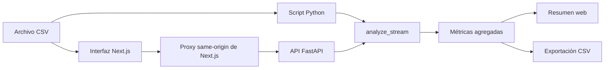

# Aprendizaje: analizador de incidencias de TrackFlow

Este documento recorre la solución de principio a fin para que puedas entender cómo el CSV pasa de una carga local a un resumen que se puede consultar y exportar, sin mostrar los datos personales de cada fila.

## 1. Qué construye el proyecto

La solución tiene tres capas que comparten la misma lógica de análisis:



El script permite validar el proceso desde la terminal. La API vuelve a utilizar las mismas funciones para procesar cargas web. La interfaz presenta los agregados y ofrece su descarga.

## 2. Cómo se valida y analiza el CSV

La lógica principal está en `scripts/analyze.py`:

- `validate_record` comprueba cada registro según los formatos y valores de TrackFlow: identificador, fecha, país, tipo de cliente, tracking, carrier por país, categoría, descripción, correo, estado y puntuación.
- `satisfaction_score` puede no existir como columna. Si una fila está en estado `CLOSED`, sí necesita una puntuación entre 1 y 5; en otros estados puede quedar vacía.
- `analyze_stream` lee el CSV registro por registro y conserva contadores, no las filas originales. Si una fila incumple varias reglas, cuenta una vez como registro inválido y suma cada motivo que encontró.
- Las categorías, estados, países y puntuaciones se agregan únicamente para registros válidos. La media de satisfacción se calcula con los casos cerrados válidos que tienen puntuación.
- `print_report` presenta el resumen en la terminal. `write_results_csv` exporta una fila por métrica, sin copiar correos ni filas originales.

La comprobación del correo es deliberadamente sencilla: exige que el campo no esté vacío y que contenga `@`; no intenta implementar toda la especificación de direcciones de correo. Del mismo modo, las reglas de validación concretas se definen en el propio script y deben mantenerse alineadas con el briefing.

## 3. Responsabilidad de cada parte

### Script

`python3 scripts/analyze.py ruta/al/archivo.csv` recibe la ruta como argumento, imprime los agregados y pregunta si deseas exportarlos. Responde `s` para crear `results.csv` en el directorio actual o `n` para no exportar.

### API

`services/api/main.py` recibe el archivo en el campo multipart `file` del endpoint `POST /api/incidents/analyze`. Convierte el archivo a texto y llama a `analyze_stream`, la misma función usada por el CLI. La respuesta JSON contiene solo métricas agregadas.

`GET /api/incidents/results/export` devuelve el último resumen procesado como CSV. Antes del primer análisis responde `404`. Un CSV vacío o ilegible responde `400`; un esquema al que le falten columnas obligatorias responde `422`.

### Interfaz

La página `uis/talent-pipeline-tracker/app/incidents/page.tsx` carga el componente `incident-analysis.tsx`. El enlace “Incidencias” del menú está en `app/layout.tsx`. El componente permite elegir un archivo, iniciar el análisis, revisar totales, motivos de invalidez, categorías, estados, países y satisfacción, y descargar la exportación.

El navegador llama a una ruta de Next.js bajo `/api/incidents`. Esa ruta actúa como proxy hacia FastAPI usando `INCIDENTS_API_BASE_URL`; así el navegador usa el mismo origen de la aplicación y la dirección del backend no se fija en el componente.

## 4. Ejecutar en local

Desde la raíz del repositorio, prepara un entorno Python e instala las dependencias de la API:

```bash
python3 -m venv .venv
source .venv/bin/activate
python3 -m pip install -r services/api/requirements.txt
uvicorn services.api.main:app --reload
```

En otra terminal, inicia el frontend:

```bash
cd uis/talent-pipeline-tracker
npm ci
INCIDENTS_API_BASE_URL=http://127.0.0.1:8000 npm run dev
```

Abre `http://localhost:3000/incidents`. La documentación interactiva de FastAPI está en `http://127.0.0.1:8000/docs`.

Para ejecutar únicamente el script:

```bash
python3 scripts/analyze.py ruta/al/archivo.csv
```

El script escribe `results.csv` en el directorio desde el que se ejecuta, no necesariamente junto al archivo de entrada.

## 5. Privacidad y límites

El análisis conserva contadores y métricas, no valores de las filas. La aplicación no guarda el CSV de forma persistente; FastAPI puede mantener una carga temporalmente en memoria o en un archivo temporal mientras procesa la petición. Ni la respuesta JSON ni el CSV exportado incluyen correos individuales. El archivo sí pasa por el backend durante la petición, así que debe enviarse solo a una instancia interna autorizada.

La API conserva el resumen más reciente en memoria del proceso. Se pierde al reiniciar y no se comparte entre varios procesos de servidor. Por eso la exportación corresponde al último análisis recibido por ese mismo proceso, no a un historial persistente de análisis.

El archivo de prueba `Milestone-5/Analizador-de-archivos-de-incidencias/incidents-trackflow.csv` sí está en el repositorio. Se ejecutó el analizador directamente contra ese archivo y los valores coincidieron con el briefing: 100 registros, 95 válidos, 5 inválidos, los desgloses indicados y promedio de satisfacción 3.06. La salida contiene métricas agregadas, no correos ni filas originales.

## 6. Comprobaciones realizadas

- ESLint del componente de análisis y build de producción de Next.js.
- El CLI presenta el prompt de exportación y acepta las respuestas `s` y `n`.
- La exportación del CLI contiene métricas agregadas y no contiene el correo sintético utilizado en la prueba.
- La API responde `422` con un mensaje descriptivo cuando faltan encabezados obligatorios.
- Un CSV sin la columna `satisfaction_score` acepta filas abiertas sin puntuación y marca como inválida una fila cerrada sin ella.
